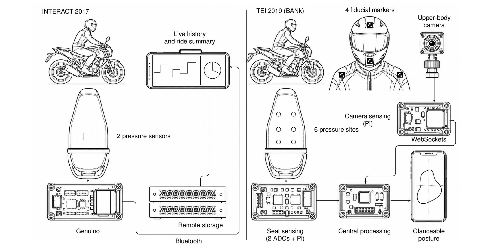

# ReRide

ReRide investigates how motorbike riders can use feedback about their posture
as part of everyday commuting. The research connects **personal informatics**,
using personal data for reflection, with **embodied self-monitoring**, connecting
feedback to the bodily activity that produces it.

The two publications address a shared question: **how can posture sensing and
feedback be integrated into the experience of riding, and support reflection
before, during and after a commute?**



*ReRide connects posture sensing with feedback during a commute and data for
later reflection. Left: the INTERACT 2017 demonstration. Right: the TEI 2019
BANk architecture and module explorations. Hardware and screen content are
conceptual illustrations; the 2019 paper identifies full system integration
and evaluation as future work.* [PDF](assets/reride.pdf).

## Publications

### INTERACT 2017

**ReRide: A Platform to Explore Interaction with Personal Data Before, During,
and After Motorcycle Commuting**

Naveen Bagalkot, Tomas Sokoler, Riyaj Shaikh, Gaurav Singh, Anders Edelbo Lillie,
Pratiksha Dixit, Aditi Rai, Chakravarthy Vignesh and Ashwin Senthil.

Srishti Institute of Art, Design, and Technology, Bangalore, India, and the
Digital Design Department, IT University of Copenhagen, Denmark.

System demonstration published in *Human-Computer Interaction – INTERACT 2017*,
Lecture Notes in Computer Science, volume 10516, Springer, pages 420–423.

[Publisher and full paper](https://doi.org/10.1007/978-3-319-68059-0_43)

**Abstract**

The motorcycle could soon be the new frontier for the exploration of human interaction with advanced digital technology. In this paper we present a demo of a system designed and implemented to explore the design of personal informatics tools for motorbike commuting and help us conduct in-situ evaluation of such tools. We present the system architecture and demonstrate the capabilities of the system by presenting a case instantiation in the form of an interactive soft-and-hardware prototype that collects rider’s posture data, visualizes the data on the motorbike dashboard in real-time, and pushes the data to the cloud server for later retrieval.

### TEI 2019

**ReRide: A Bike Area Network for Embodied Self-monitoring during Motorbike
Commute**

Naveen L. Bagalkot, Gaurav Singh, Vineeta Rath, Tomas Sokoler and Anchit Shukla.

Srishti Institute of Art, Design, & Technology, Bengaluru, India;
IT University of Copenhagen, Denmark; and Indian Institute of Technology Roorkee,
India.

Published in the *Proceedings of the Thirteenth International Conference on
Tangible, Embedded, and Embodied Interaction (TEI 2019)*, ACM, pages 443–450.

[Publisher](https://doi.org/10.1145/3294109.3300986).
[Author copy, IT University of Copenhagen](https://researcher.itu.dk/ws/files/85588649/TS_ReRide.pdf).

**Abstract**

Motorbike commuting is the new frontier for exploring digital technology where designing for embodied interaction takes on a more central role. In this paper, building on previous work on embodied self-monitoring, we present our ongoing work of designing a modular platform with a particular focus on real-time estimation and presentation of posture data while riding. In particular, we present ‘Bike Area Network’ (BANk) as a system architecture to help guide the design of such a platform. We share our ongoing work as an invitation for the community of researchers and practitioners of designing for embodied interaction to further explore this new frontier of research.

## Research approach

The 2017 paper introduces a connected sensing and display platform. The 2019
paper builds on that work with **Bike Area Network (BANk)**, a modular
architecture for connecting sensors, processing and rider feedback.

| Aspect | [INTERACT 2017](https://doi.org/10.1007/978-3-319-68059-0_43) | [TEI 2019](https://doi.org/10.1145/3294109.3300986) |
| --- | --- | --- |
| Sensing | Two force-sensitive resistors under the seat capture pressure changes. | A seat-pressure matrix and camera-tracked markers provide complementary cues about body position. |
| Processing | A Genuino microcontroller transmits readings over Bluetooth to a connected display. | Raspberry Pi sensing modules communicate with a central processing module over WebSockets. |
| Feedback | A dashboard-mounted screen shows recent readings and variation over a ride. | A changing-shape visualization explores how to make posture information glanceable. |
| Connectivity | Cloud storage enables later retrieval. | BANk separates sensing, processing and display modules, with connectivity to a remote server. |

## Contribution and evidence

**INTERACT 2017** contributes an implemented system demonstration for exploring
interaction with rider data. Its pressure-sensing and dashboard-feedback example
shows how the platform can support experiments with personal informatics during
motorcycle commuting.

**TEI 2019** contributes the BANk architecture and the design of sensing and
feedback modules. It describes how seat pressure and upper-body markers could
be combined to estimate posture attributes, and how those attributes could
inform rider feedback.

The papers document design and prototype development. In the 2019 paper,
integration into a fully working motorbike-mounted system, further studies with
ride data and development of an LSTM learning model are identified as future
work. Posture-estimation accuracy and effects on health or riding behaviour
remain questions for evaluation.

## Citations

### INTERACT 2017

```bibtex
@inproceedings{bagalkot2017reride,
  author = {Bagalkot, Naveen and Sokoler, Tomas and Shaikh, Riyaj and
            Singh, Gaurav and Lillie, Anders Edelbo and Dixit, Pratiksha and
            Rai, Aditi and Vignesh, Chakravarthy and Senthil, Ashwin},
  title = {{ReRide}: A Platform to Explore Interaction with Personal Data
           Before, During, and After Motorcycle Commuting},
  booktitle = {Human-Computer Interaction -- INTERACT 2017},
  series = {Lecture Notes in Computer Science},
  volume = {10516},
  year = {2017},
  pages = {420--423},
  publisher = {Springer International Publishing},
  address = {Cham},
  doi = {10.1007/978-3-319-68059-0_43},
  url = {https://doi.org/10.1007/978-3-319-68059-0_43}
}
```

### TEI 2019

```bibtex
@inproceedings{bagalkot2019reride,
  author = {Bagalkot, Naveen L. and Singh, Gaurav and Rath, Vineeta and
            Sokoler, Tomas and Shukla, Anchit},
  title = {{ReRide}: A Bike Area Network for Embodied Self-monitoring
           during Motorbike Commute},
  booktitle = {Proceedings of the Thirteenth International Conference on
               Tangible, Embedded, and Embodied Interaction},
  year = {2019},
  pages = {443--450},
  publisher = {Association for Computing Machinery},
  doi = {10.1145/3294109.3300986},
  url = {https://doi.org/10.1145/3294109.3300986}
}
```
